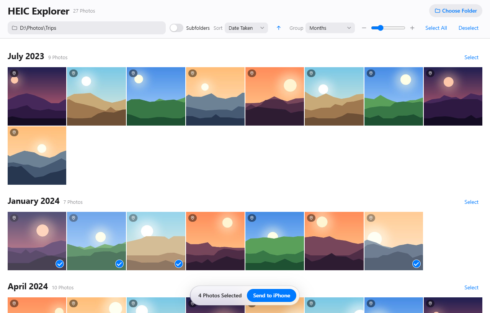
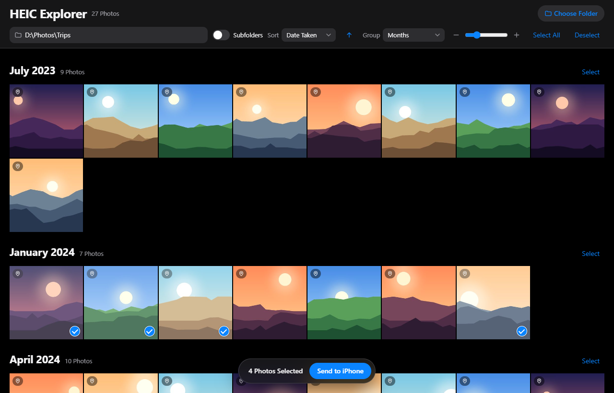
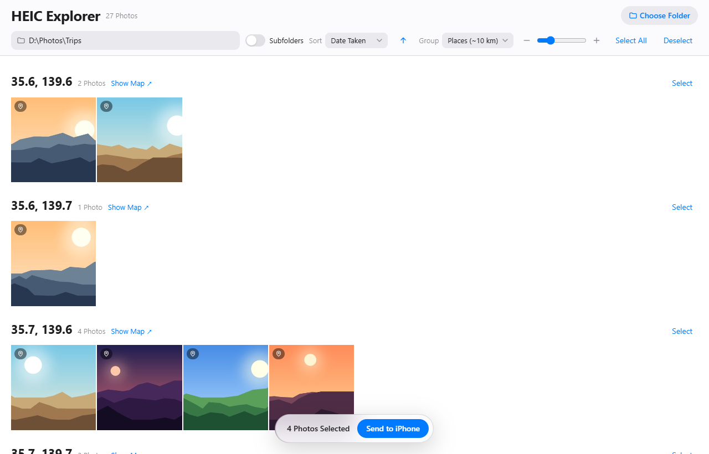
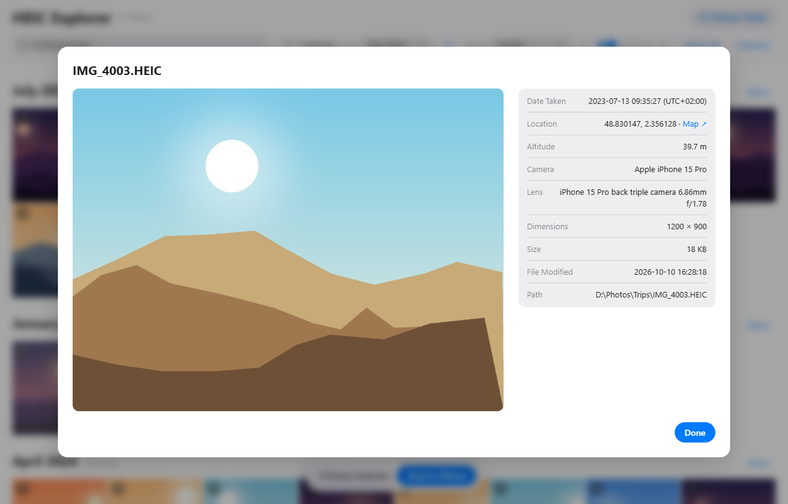
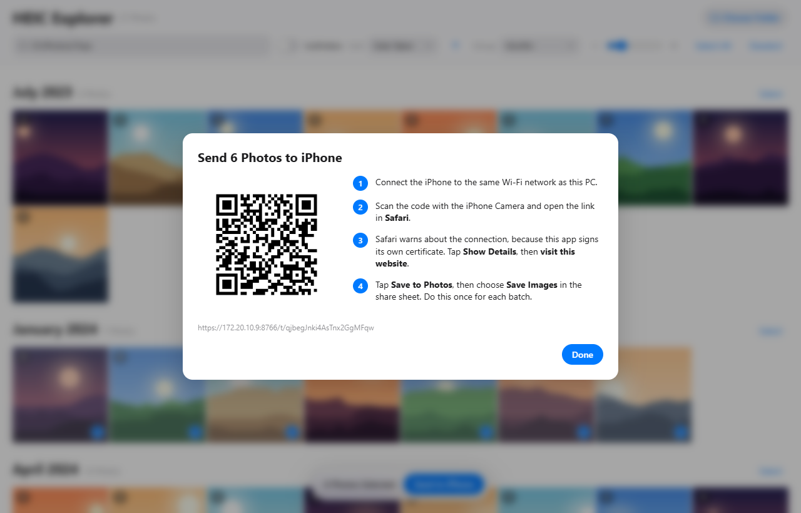
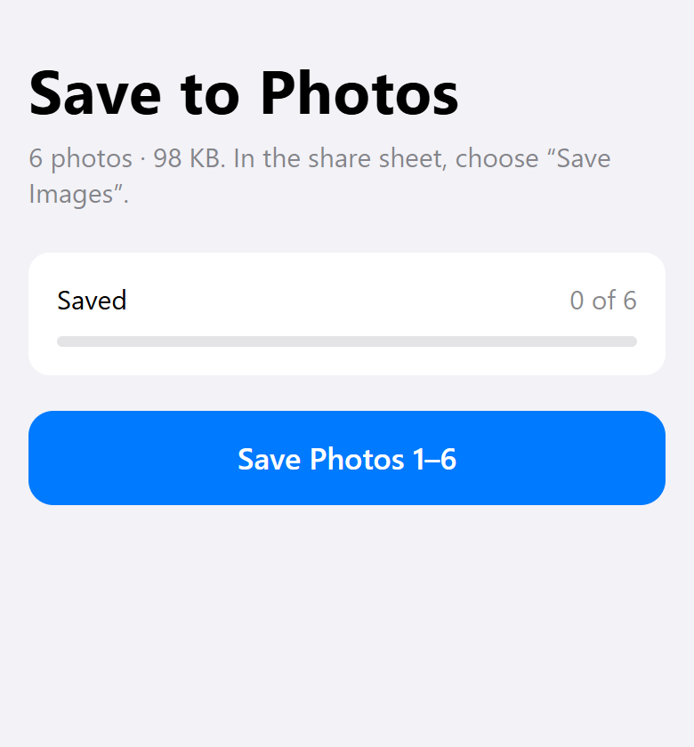

# HEIC Manager

### What is it?
Manages HEIC media files on Windows - shows them and lets you transfer them over to your iPhone.

### Usage

Double-click `run.bat` (or run `./run.sh`). The manager opens in your browser at http://127.0.0.1:8765.

- **Choose folder…** lists the HEIC files in a folder, optionally including subfolders.
- **Sort** by date taken, file date, name, size, latitude, longitude or camera. **Group** by year, month, day, location (about 1 km or 10 km) or camera, or by whether a photo has GPS.
- **Click** a photo to select it, **shift-click** to select a range, and **double-click** to see all its metadata.
- **Send to iPhone** shows a QR code. Open it in Safari on the iPhone (same Wi-Fi), accept the self-signed certificate warning, and tap **Save to Photos → Save Images**.
  The original files are sent unchanged, so Photos places each one by its EXIF date and location.
  Photos with no "date taken" are flagged, because Photos would put them on the day they are imported.

The first time it runs, Windows Firewall may ask to allow Python on private networks. Allow it, or the iPhone can't connect.

### Screenshots

<table>
  <tr>
    <td> Dark mode</td>
    <td> Grouped by place, with map links</td>
  </tr>
  <tr>
    <td> Double-click a photo for its metadata</td>
    <td> Send to iPhone: scan the QR code</td>
  </tr>
  <tr>
    <td colspan="2" align="center"> The page that opens on the iPhone</td>
  </tr>
</table>

The screenshots use generated sample photos.
